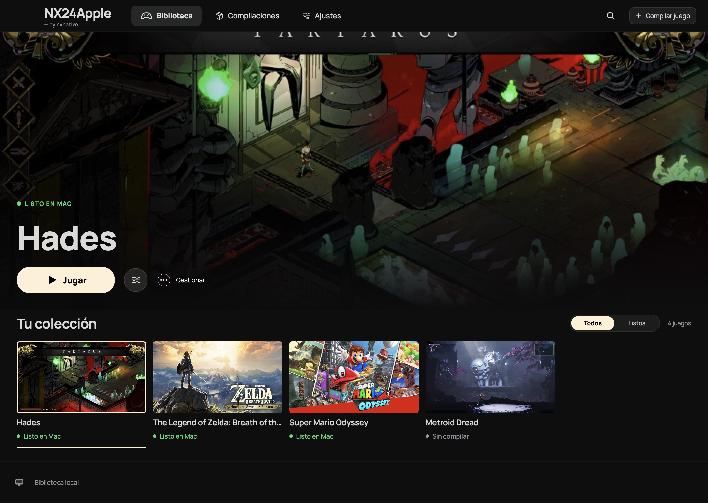
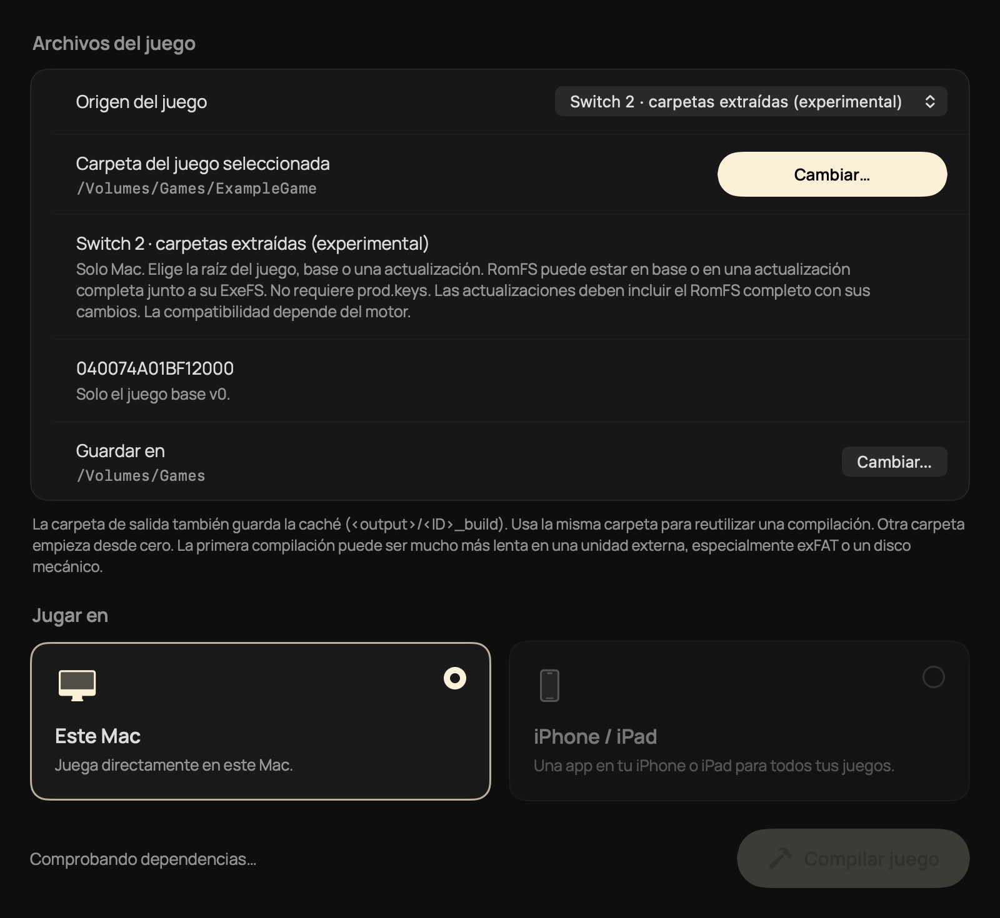
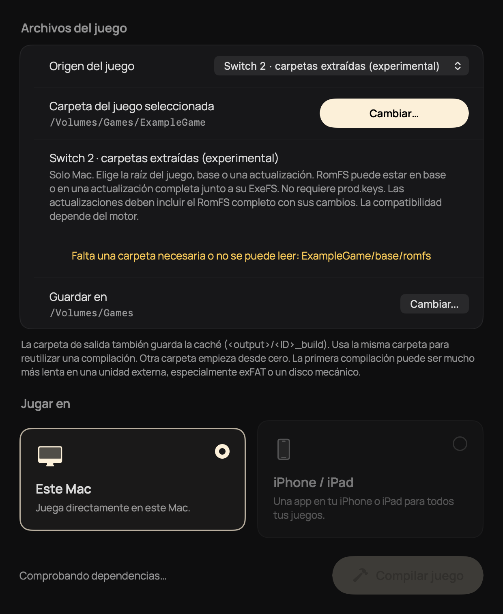
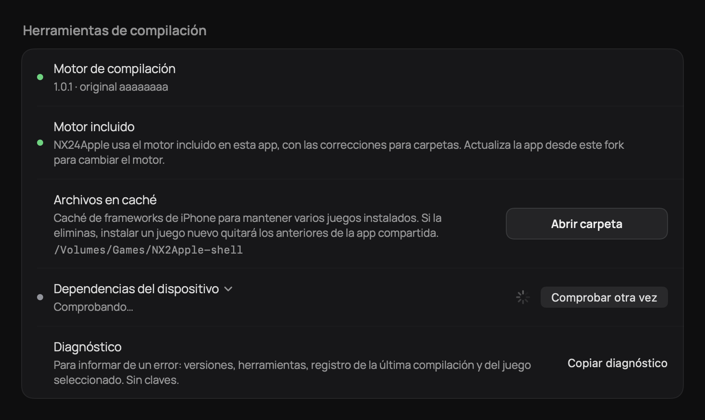
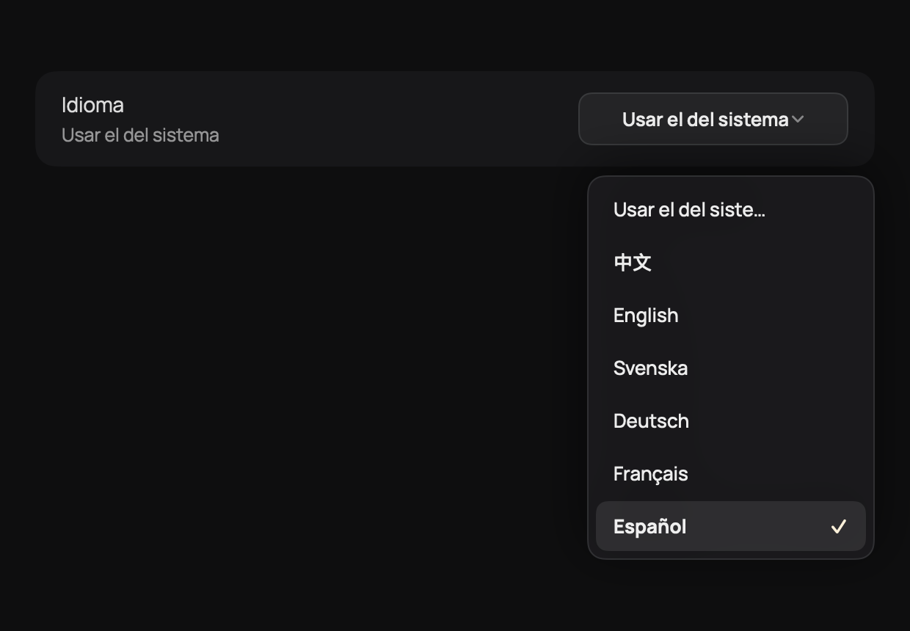
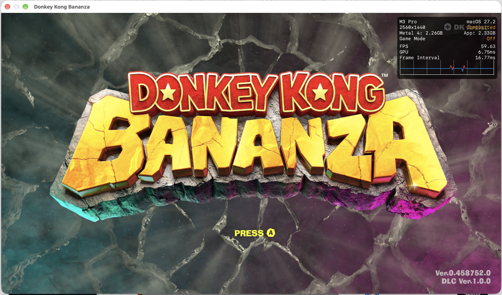

# NX24Apple

Fork personal de [NX2Apple](https://github.com/LNPANDY/NX2Apple), mantenido por [@josellopz](https://github.com/josellopz), con integración experimental de juegos extraídos de Nintendo Switch 2 en la interfaz macOS.

[Descargar la última versión de este fork](https://github.com/josellopz/NX2Apple/releases/latest) · [Cambios de Switch 2](https://github.com/josellopz/NX2Apple/pull/1) · [Documentación del proyecto original](README.upstream.md)

## Qué añade este fork

- Selección de carpetas ExeFS/RomFS desde la app, con comprobación de archivos, ID de título y versiones.
- Detección de RomFS en `base/romfs` o en una actualización completa de `updates/<versión>/romfs` junto a su ExeFS. Se conservan las versiones y no se mezcla código de una versión con datos de otra.
- Selección desde la raíz del juego, `base`, `updates`, una versión o sus carpetas ExeFS/RomFS.
- Mensajes claros si faltan archivos, la estructura está incompleta o el motor no tiene un perfil para el juego.
- Flujo de compilación de apps para Mac y conservación de la entrada NSP/XCI de Switch 1.
- Interfaz en español, con detección del idioma del sistema y selector manual en Ajustes. El nombre visible de la app es NX24Apple.
- Uso automático del motor incluido del fork, aunque una instalación anterior haya dejado seleccionado Experimental. El motor se actualiza al descargar una nueva versión de este fork.

## Capturas de la app

Capturas nativas de la interfaz en español, generadas con datos de ejemplo para revisar el diseño. La biblioteca ilustrada no indica compatibilidad verificada de cada juego.

## Donkey Kong Bananza en un M3 Pro

Captura aportada por @josellopz en su MacBook Pro M3 Pro. El contador muestra aproximadamente 60 FPS en la pantalla de título. El usuario también informó de ejecución a 30/60 FPS. Es una observación de su equipo, no una medición sostenida de todas las escenas ni una garantía para otros juegos.

## Descargar y abrir

1. Descarga el ZIP para macOS arm64 desde las [versiones de este fork](https://github.com/josellopz/NX2Apple/releases/latest).
2. Descomprime la carpeta completa.
3. Cuando termine cualquier compilación en curso, cierra la otra copia de NX2Apple o NX24Apple y abre **NX24Apple.app**. La propia app selecciona el motor corregido incluido. **Abrir NX24Apple.command** es un acceso alternativo que comprueba si hay otra instancia abierta.
4. En **Compilar juego**, elige el origen experimental de carpetas y selecciona tu juego.
5. Para cambiar el idioma manualmente, usa **Ajustes > Idioma > Español**.

La app comparte biblioteca y configuración con NX2Apple instalado. El cambio de nombre conserva el identificador de la app y las rutas existentes. Los registros internos del motor y el idioma de los juegos se gestionan por separado. El paquete usa firma ad hoc y no está notarizado por Apple. Incluye Python y herramientas de compilación. No contiene juegos, claves, volcados ni apps de juegos generadas.

## Requisitos y límites

- Mac con Apple silicon y macOS 13 o posterior para abrir la app.
- Xcode y las herramientas Apple que requiera el juego. Los juegos NVN del motor incluido requieren Xcode 27.2 y macOS 26.6 o posterior.
- Archivos de tus propios juegos y un perfil compatible en el motor. El modo de carpetas extraídas no requiere `prod.keys`. Los paquetes cifrados de Switch 1 sí lo requieren.
- El ExeFS base debe incluir `main` y `main.npdm`. Las actualizaciones deben estar completas.
- No todos los juegos de Switch 2 son compatibles. Pokopia todavía carece de perfil en el motor incluido.

## Créditos y licencia

NX24Apple parte de **[NX2Apple, de LNPANDY y sus colaboradores](https://github.com/LNPANDY/NX2Apple)**. La ejecución nativa, el reescritor de código, la capa Horizon, NVN sobre Metal y los perfiles de juegos proceden de **[nxnative, de seedds y sus colaboradores](https://github.com/seedds/nxnative)**.

Este fork se centra en su interfaz y en la integración experimental de carpetas. Conserva los avisos de copyright y la [licencia MIT original](LICENSE). La documentación original permanece en [README.upstream.md](README.upstream.md).
